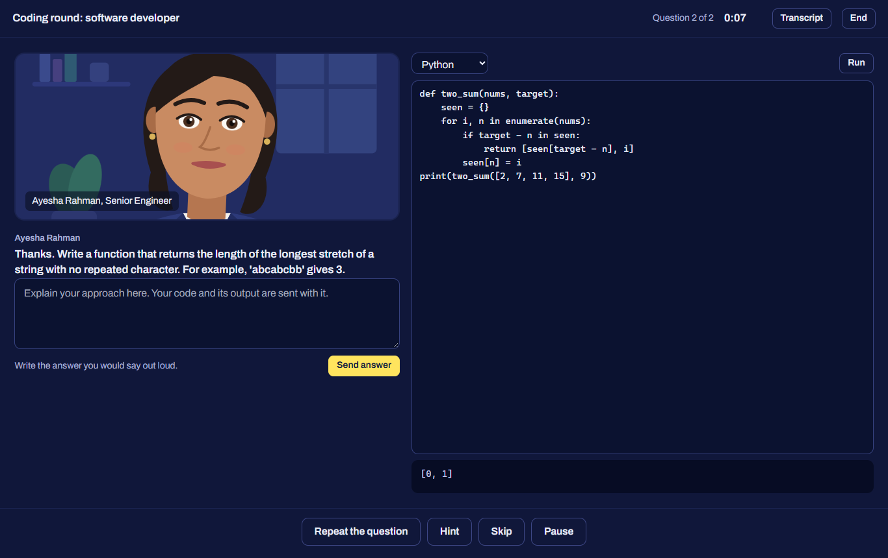
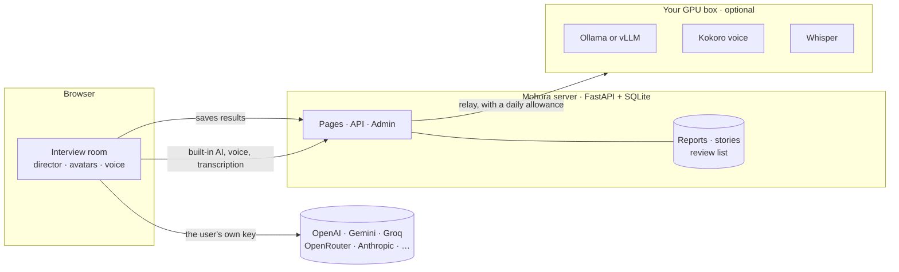

<div align="center">


# Mohora

**Rehearse your next interview out loud.**

An AI interviewer that reads your CV, follows up on what you actually said, and marks up every answer.<br>
Free with your own AI key, or with a built-in AI on your own GPU. Open source and easy to self-host.

[](https://github.com/shizan52/mohora/actions/workflows/ci.yml)
[](LICENSE)
[](pyproject.toml)
[](docker-compose.yml)
[](docs/deploy.md)

[Quick start](#quick-start) · [Features](#what-it-does) · [Deploy](docs/deploy.md) · [GPU server](docs/gpu.md) · [Contributing](CONTRIBUTING.md)

<br>


</div>

<br>

## Why it exists

Interview practice tools mostly stop at one mock interview and a score. Reviews of the big ones keep repeating the same complaints: feedback that is generic and repetitive, no memory between sessions, nothing tied to the date of the real interview, and subscriptions that are hard to cancel.

Mohora is built around those gaps.

- **Specific feedback.** Your own words come back highlighted, scored on five points for that interview type, with a rewrite that keeps your story. Behavioral answers show which STAR parts were there and which were missing.
- **It remembers.** Any answer scored under 4 out of 5 returns in a five-minute drill after one, three and seven days, until you get it right three times in a row.
- **It knows your date.** Set the interview date and get one short session per day, a light day before and a warm-up on the day, with a readiness score that shows exactly what would raise it.
- **Questions about your work.** Upload a CV and the interviewer asks about your real projects, not a generic list.
- **No lock-in.** Practice is free. Pro is a one-off USDT payment, not a subscription.

<div align="center">

</div>

## What it does

| | |
|---|---|
| **CV first** | Upload a PDF or Word CV. The AI reads it, suggests roles from internship to lead, and lists the topics an interviewer will ask about. You pick the topics. A job post gives you a screening score, missing keywords and CV fixes. |
| **Twelve interview types** | Behavioral, role interview, HR and first job, job description match, application questions, recruiter screen, final round and a **coding round** are free. **Salary negotiation, US student visa (F-1), IELTS speaking and viva board** are Pro, each with one free try. |
| **The whole hiring process** | Practise the steps of a real application in order, from the online form to the final round, skipping any you don't need. |
| **Five ways to talk** | Video call, voice call, listen and type, read and speak, or plain text. |
| **Interviewers with faces** | Two drawn interviewers who blink, look up while thinking, nod while you speak, raise their brows on a follow-up and move their lips with the audio of their voice. |
| **Natural voices** | Edge's neural voices, an in-browser neural voice (Kokoro), OpenAI's voice with your key, or your own GPU server's voice. |
| **A real coding round** | A code editor beside the interviewer. Run Python or JavaScript in the browser; the interviewer reads your code and its output and asks about complexity and edge cases. |
| **Delivery signals** | Words per minute, filler words (English and Bangla), time before you start answering, and in video mode how often you faced the screen, computed on your device. |
| **Stories and drills** | A STAR story bank with the kinds you're missing, and short drills on the answers that went badly. |
| **Share and invite** | A public result page with scores only, a LinkedIn share button, and an invite link that gives you both a week of Pro. |
| **English and Bangla** | Interviews and feedback in both. Bangla speech is recognised by Chrome, or by Whisper on your GPU server. |
| **For the owner** | Admin panel with funnel and usage numbers, users, interview types and prompts editable as JSON, payment review, site flags, a Telegram alert for every new sign-up and a daily digest at 9 pm. |

<div align="center">
 
</div>

## Quick start

### On your computer

Python 3.12 or newer.

```bash
git clone https://github.com/shizan52/mohora.git
cd mohora
python run.py
```

The first run creates a virtual environment, installs the packages, asks a few questions to write `.env`, creates the database and opens the browser. Without Google credentials the sign-in page offers an email-only login for local testing. Then open **New interview**, connect an AI (a free [Google Gemini](https://aistudio.google.com/apikey) or [Groq](https://console.groq.com/keys) key takes a minute) and start.

### On a server, with Docker

```bash
git clone https://github.com/shizan52/mohora.git && cd mohora
cp .env.example .env          # set BASE_URL, DOMAIN, SECRET_KEY, ADMIN_EMAILS, Google keys
docker compose up -d --build
```

That gives you the site on your domain with automatic HTTPS (Caddy), a SQLite database in a volume and daily backups. The step-by-step guide, including Google sign-in, Telegram alerts and payments, is in **[docs/deploy.md](docs/deploy.md)**.

### On a GPU server

```bash
docker compose --profile gpu up -d --build
```

This adds a built-in AI (Ollama), a natural voice (Kokoro) and Bangla-capable speech recognition (Whisper), so visitors can practise with no API key at all. Sizing, model choices and capacity are in **[docs/gpu.md](docs/gpu.md)**.

## How it works



The model only voices the interviewer. A small **director** in [`static/room.js`](static/room.js) owns the interview: it decides when to ask a follow-up, when to move on, when feedback appears and how the rubric is applied. The model gets one short instruction per turn and must answer in JSON. That is what keeps small free models on track, and it is why every interview type can be plain data in [`app/packs.json`](app/packs.json), editable from the admin panel without a deploy.

By default the AI calls go from the visitor's browser straight to their provider, so the server never sees keys or CVs and has no AI bill. With a GPU, the same calls go through a relay with a daily allowance per person.

## Interview types

| Type | Plan | What it practises |
|---|---|---|
| Behavioral | Free | Stories from your past work, scored on STAR |
| Role interview | Free | Questions for the exact job: concepts, past work, problem solving |
| HR and first job | Free | Why this job, strengths and weaknesses, where you see yourself |
| Job description match | Free | Questions built from a pasted job post and your CV |
| Application questions | Free | The written questions online job forms ask |
| Recruiter screen | Free | The first short call: background, motivation, salary, start date |
| Final round | Free | The hiring manager: judgement, working style, the offer |
| Coding round | Free | Two small problems in an editor while you explain your thinking |
| Salary negotiation | Pro | Asking for more without losing the offer |
| US student visa (F-1) | Pro | The two-minute interview at the visa window |
| IELTS speaking | Pro | All three parts with an examiner |
| Viva board | Pro | The oral exam for government and bank jobs |

A new type is a JSON entry: interviewer, opener, question bank, rubric and rules. See [CONTRIBUTING.md](CONTRIBUTING.md).

## Documentation

| | |
|---|---|
| [docs/deploy.md](docs/deploy.md) | Production deployment: DNS, HTTPS, Google sign-in, Telegram, payments, backups, updates, troubleshooting, and every setting. |
| [docs/gpu.md](docs/gpu.md) | The GPU profile: choosing a model, capacity, a separate GPU machine, languages. |
| [SECURITY.md](SECURITY.md) | How keys, CVs and transcripts are handled, and how to report a problem. |
| [CONTRIBUTING.md](CONTRIBUTING.md) | Running the tests, where things live, adding an interview type. |

## Project layout

```
run.py              one entry point: setup, dev, prod, check, backup, health, deploy
app/main.py         pages, API, security headers
app/auth.py         Google sign-in, local sign-in, guards
app/billing.py      Pro passes, USDT payments, TRON verification
app/practice.py     review drills, readiness score, plan, stories, sharing, question library
app/house.py        the built-in GPU AI: chat, voice and transcription relay
app/admin.py        admin panel
app/notify.py       Telegram alerts and the daily digest
app/db.py           models, migrations, settings
app/packs.json      interview types, hiring journey, prompts, sample report
static/room.js      interview room and director
static/setup.js     setup wizard
static/avatar.js    animated interviewers
static/voice.js     speech in and out, voice engines, answer metrics
static/app.js       AI connections and shared helpers
docker-compose.yml  site + HTTPS + backups, and a gpu profile
tests/              pytest suite
```

## Decisions worth explaining

- **Bring your own AI.** Paying for every visitor's tokens would make a free tier impossible. With BYOK the running cost is a small server, and the GPU profile is an upgrade rather than a requirement.
- **No build step.** Plain ES modules, one CSS file, server-rendered templates. The source the browser runs is the source in this repository.
- **SQLite.** One file in WAL mode, daily backups, nothing to operate. It is the part to replace if you ever outgrow it.
- **Drawn avatars, not video avatars.** Photo-real talking heads need paid APIs. Animated SVG faces are free, instant and honest about being a practice partner.
- **Practice, not cheating.** There is no live copilot that whispers answers during a real interview, and there won't be.

## Honest limits

- The eye-contact estimate in video mode comes from a small face model and is rough; it is shown as a trend, not a grade.
- Scores come from an AI and can be wrong. The viva and IELTS types in particular depend on how good the model is, and say so on the page.
- Kokoro speaks English only, so Bangla interviews use the browser's own voice.
- The GPU services in `docker-compose.yml` follow each project's documented images but were written without a GPU at hand; [docs/gpu.md](docs/gpu.md) lists what to check on first run.
- Not built yet: panel interviews with several interviewers, a pressure mode, a one-way AI-screener simulation, and organisation accounts for coaching centres.

## Contributing

Issues and pull requests are welcome. Start with [CONTRIBUTING.md](CONTRIBUTING.md); `python run.py check` runs the lint and the tests.

## License

[MIT](LICENSE) © 2026 Tayb Hassan Shizan.
