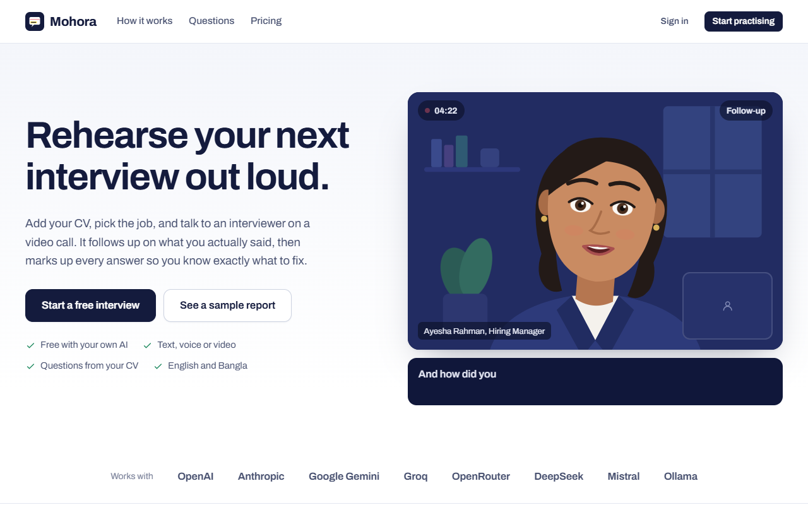
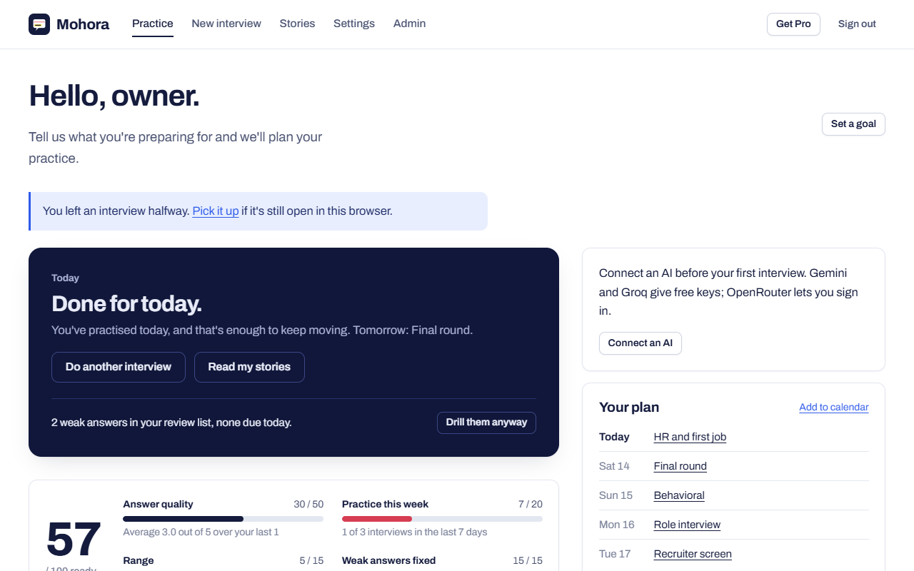
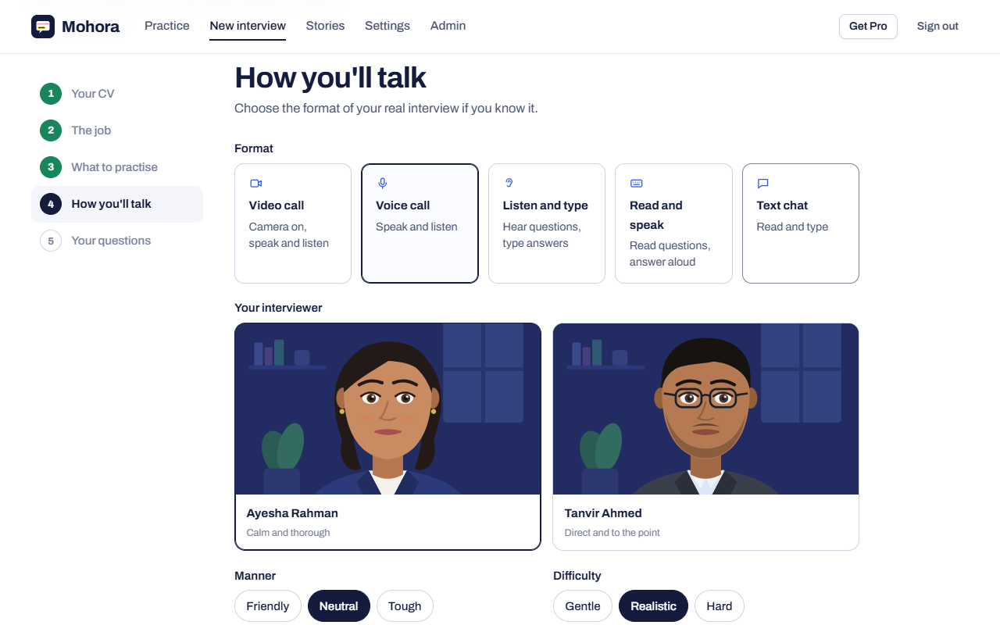
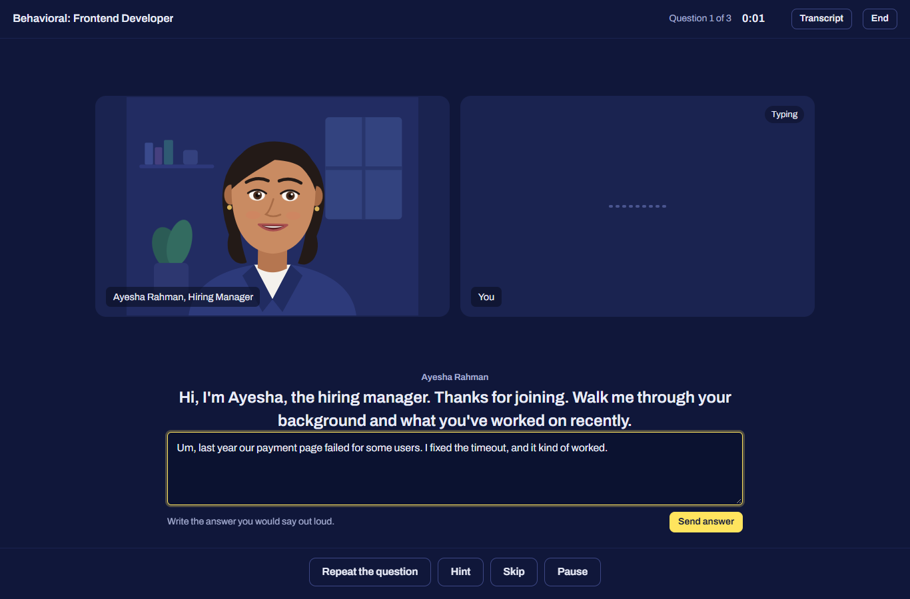
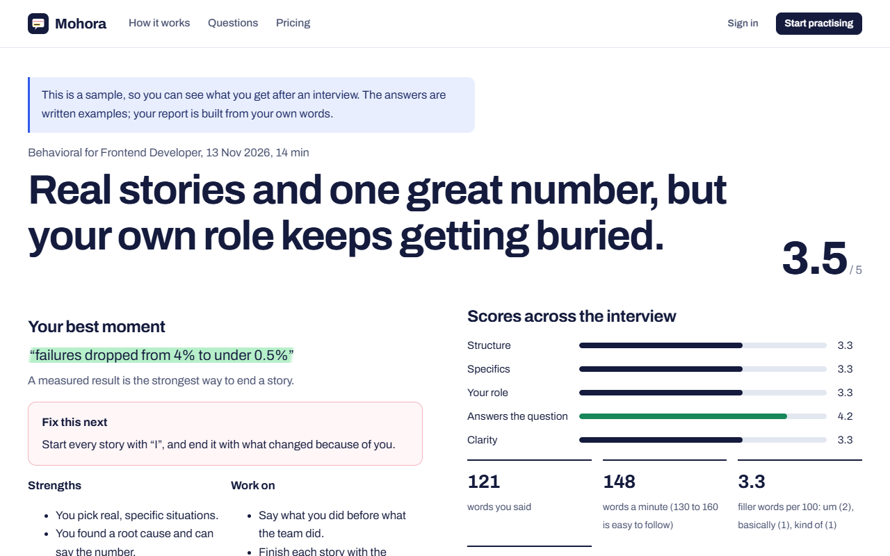
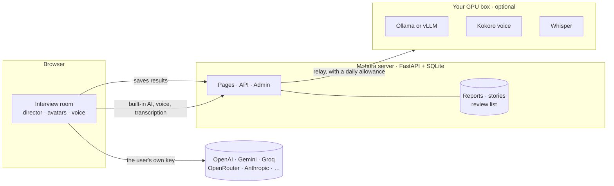

<p align="center">
  
</p>

<h1 align="center">Mohora</h1>

<p align="center">
  <b>Rehearse your next interview out loud.</b><br>
  An AI interviewer that reads your CV, follows up on what you actually said, and marks up every answer.<br>
  Free with your own AI key, or with a built-in AI on your own GPU server. Open source and easy to self-host.
</p>

<p align="center">
  
  
  
  
  
  
  
  
</p>

<p align="center">
  <a href="#-run-it">Run it</a> ·
  <a href="docs/deploy.md">Deploy to a server</a> ·
  <a href="docs/gpu.md">GPU server</a> ·
  <a href="#-engineering-highlights">Engineering highlights</a> ·
  <a href="CONTRIBUTING.md">Contributing</a>
</p>

> **The screenshots use sample data.** The names, CV and answers you see are made up. The product behind them is real, working code that you can run yourself in a few minutes.

---

## 💡 What it is

Interview practice tools mostly stop at one mock interview and a score. Reviews of the big ones keep repeating the same complaints: feedback that is generic and repetitive, no memory between sessions, nothing tied to the date of the real interview, and subscriptions that are hard to cancel. I built Mohora around those gaps:

- **Specific feedback.** Your own words come back highlighted, scored on five points for that interview type, with a rewrite that keeps your story. Behavioral answers show which STAR parts were there and which were missing.
- **It remembers.** An answer scored under 4 out of 5 returns in a five-minute drill after one, three and seven days, until you get it right three times in a row.
- **It knows your date.** Set the interview date and get one short session per day, a light day before and a warm-up on the day, with a readiness score that shows exactly what would raise it.
- **Questions about your work.** Upload a CV and the interviewer asks about your real projects, not a generic list.
- **No lock-in.** Practice is free. Pro is a one-off USDT payment, not a subscription.

```text
  CV + job post --> pick the interview --> talk to the interviewer --> marked-up report
  (read in your      (12 types, 5 ways       (video, voice or text,        |
   browser)           to talk)                follow-ups, a code editor)   v
                                                                   drills on weak answers,
                                                                   plan, readiness score, stories
```

---

## 📸 Screenshots

<table>
  <tr>
    <td width="50%"><br><sub><b>Practice hub.</b> Today's session, a readiness score you can see into, and a plan that counts down to the interview.</sub></td>
    <td width="50%"><br><sub><b>Setup.</b> Five ways to talk, two interviewers, and the questions written from your CV.</sub></td>
  </tr>
  <tr>
    <td width="50%"><br><sub><b>Interview room.</b> The interviewer listens, follows up and speaks with live captions.</sub></td>
    <td width="50%"><br><sub><b>Coding round.</b> An editor beside the interviewer. Python and JavaScript run in the browser.</sub></td>
  </tr>
  <tr>
    <td colspan="2"><br><sub><b>The report.</b> What worked, what to fix next, and your own words marked up. <a href="docs/images/report.png">Full size</a></sub></td>
  </tr>
</table>

---

## ✨ Features

| | |
|---|---|
| **CV first** | Upload a PDF or Word CV. The AI reads it, suggests roles from internship to lead, and lists the topics an interviewer will ask about. A job post gives a screening score, missing keywords and CV fixes. |
| **Twelve interview types** | Behavioral, role interview, HR and first job, job description match, application questions, recruiter screen, final round and a **coding round** are free. **Salary negotiation, US student visa (F-1), IELTS speaking and viva board** are Pro, each with one free try. |
| **The whole hiring process** | Practise a real application in order, from the online form to the final round, skipping any step. |
| **Five ways to talk** | Video call, voice call, listen and type, read and speak, or plain text. |
| **Interviewers with faces** | Two drawn interviewers who blink, look up while thinking, nod while you speak, raise their brows on a follow-up and move their lips with the audio of their voice. |
| **Natural voices** | Edge's neural voices, an in-browser neural voice (Kokoro), OpenAI's voice with your key, or your own GPU server's voice. |
| **A real coding round** | The interviewer reads your code and its output and asks about complexity and edge cases. |
| **Delivery signals** | Words per minute, filler words (English and Bangla), the pause before you answer and, in video mode, how often you faced the screen, computed on your device. |
| **Stories and drills** | A STAR story bank that shows which kinds you're missing, and short drills on the answers that went badly. |
| **Share and invite** | A public result page with scores only, a LinkedIn button, and an invite link that gives you both a week of Pro. |
| **Bring any AI** | Sign in with OpenRouter or Puter, paste a key (Gemini, Groq, OpenAI, Anthropic, DeepSeek, Mistral, xAI, Cerebras), point at any OpenAI-compatible server, run Ollama or LM Studio locally, or use the site's built-in AI. |
| **English and Bangla** | Interviews and feedback in both. Bangla speech is recognised by Chrome, or by Whisper on your GPU server. |
| **For the owner** | Admin panel with funnel and usage numbers, users, interview types and prompts editable as JSON, payment review, site flags, a Telegram alert for every new sign-up and a daily digest. |

### Interview types

| Type | Plan | What it practises |
|---|---|---|
| Behavioral | Free | Stories from your past work, scored on STAR |
| Role interview | Free | Questions for the exact job: concepts, past work, problem solving |
| HR and first job | Free | Why this job, strengths and weaknesses, where you see yourself |
| Job description match | Free | Questions built from a pasted job post and your CV |
| Application questions | Free | The written questions online job forms ask |
| Recruiter screen | Free | The first short call: background, motivation, salary, start date |
| Final round | Free | The hiring manager: judgement, working style, the offer |
| Coding round | Free | Two small problems in an editor while you explain your thinking |
| Salary negotiation | Pro | Asking for more without losing the offer |
| US student visa (F-1) | Pro | The two-minute interview at the visa window |
| IELTS speaking | Pro | All three parts with an examiner |
| Viva board | Pro | The oral exam for government and bank jobs |

A new type is one JSON entry: interviewer, opener, question bank, rubric and rules. See [CONTRIBUTING.md](CONTRIBUTING.md).

---

## 🧠 Engineering highlights

- **The model only voices the interviewer.** A small *director* in [`static/room.js`](static/room.js) owns the interview. It decides when to ask a follow-up (one or two per question, by difficulty), when to move on, when feedback appears and how much time is left. The model gets one short instruction per turn and must answer in JSON, and the director overrides any reply that breaks the plan, such as wrapping up before the last question. That is what keeps small free models on track, and it is why every interview type can be plain data in [`app/packs.json`](app/packs.json).
- **No AI bill for the site.** Calls go from the visitor's browser straight to their provider with their own key. The server never sees keys or CVs. The optional relay for providers that block browsers forwards only to a fixed list of provider hosts and API paths, with a per-address limit, and neither stores nor logs the key.
- **A built-in AI that can't eat the GPU.** With a GPU box behind the site, the same calls go through [`app/house.py`](app/house.py): a daily allowance per person (ten times more for Pro, a third for visitors without an account), a cap on prompt size and a cap on recording length.
- **Feedback you can act on.** The coach returns the candidate's exact words and why they were strong or weak; those are matched back into the transcript and highlighted. Structured answers also report which named parts (Situation, Task, Action, Result) were missing.
- **It remembers what went badly.** Weak answers join a review list scheduled at one, three and seven days. The readiness score is the sum of four visible parts (answer quality, practice this week, range, weak answers fixed), so it is clear how to raise it.
- **Payments without a payment processor.** A TRC20 payment is checked on the TRON blockchain: it must go to the shop's address, in the real USDT contract, for at least the price. A transaction ID can be claimed once, so one transfer can't buy two passes. Other networks go to an admin queue.
- **Safe with several workers.** Startup (create tables, migrate, seed) runs under a file lock, tested by starting six processes at once. The daily Telegram digest is claimed with one atomic `UPDATE`, so it is sent once however many workers run.
- **Voices that sound human, with a way out.** It picks the browser's neural voice when there is one, uses the in-browser Kokoro voice only if it measured faster than real time on that device, and falls back to a plain voice mid-interview if the better one fails.
- **Faces without video.** The avatars are SVG. The mouth follows the real audio level of the voice; for browser voices, which expose no audio, it follows word boundaries instead.
- **Code runs in the browser, with limits.** JavaScript runs in a throwaway worker and Python in Pyodide, both with time limits, under a strict content-security policy.
- **Privacy by default.** The admin panel shows counts and scores, never transcripts. One switch stops transcripts being saved. Shared result pages carry scores only. Settings can export or delete everything.
- **No build step.** Plain ES modules, one CSS file, server-rendered templates: about 3,200 lines of Python and 3,700 of JavaScript, no framework, no bundler.
- **Upgrades don't fight your edits.** New interview-type fields are filled in on update while your admin edits are kept, and prompts you changed are never overwritten.

---

## 🏗️ Architecture



By default the AI calls never touch the site, so running it costs a small server. With a GPU, the same calls go through a relay with a daily allowance per person.

---

## 🚀 Run it

### On your computer

Python 3.12 or newer.

```bash
git clone https://github.com/shizan52/mohora.git
cd mohora
python run.py
```

The first run creates a virtual environment, installs the packages, asks a few questions to write `.env`, creates the database and opens the browser. Without Google credentials the sign-in page offers an email-only login for local testing. Open **New interview**, connect an AI (a free [Google Gemini](https://aistudio.google.com/apikey) or [Groq](https://console.groq.com/keys) key takes a minute) and start.

No key at hand? `python tests/fake_ai.py` starts a fake AI on `http://127.0.0.1:8799/v1`: connect **Other server** to it and a whole interview runs offline with canned replies.

### On a server, with Docker

```bash
git clone https://github.com/shizan52/mohora.git && cd mohora
cp .env.example .env          # set BASE_URL, DOMAIN, SECRET_KEY, ADMIN_EMAILS and the Google keys
docker compose up -d --build
```

That gives you the site on your domain with automatic HTTPS (Caddy), a SQLite database in a volume and daily backups. The step-by-step guide, including Google sign-in, Telegram alerts and payments, is in **[docs/deploy.md](docs/deploy.md)**.

### On a GPU server

```bash
docker compose --profile gpu up -d --build
```

This adds a built-in AI (Ollama), a natural voice (Kokoro) and Bangla-capable speech recognition (Whisper), so visitors can practise with no API key at all. Sizing, model choices and capacity are in **[docs/gpu.md](docs/gpu.md)**.

| Command | What it does |
|---|---|
| `python run.py` | Development server with auto-reload |
| `python run.py check` | Lint (ruff) and tests (pytest) |
| `python run.py prod` | Production server |
| `python run.py admin you@example.com` | Make a user an admin |
| `python run.py backup` | Copy the database into `backups/` |
| `python run.py tg-test` | Send a Telegram test message and show chat ids |
| `python run.py deploy` | Print a systemd unit and Caddy config for your domain |

---

## 🧪 Testing

**30 automated tests** run the whole app in-process against a throwaway database, with no network:

- sign-in, CSRF on every write, and that one person's interviews and stories are invisible to another;
- the transcript switch, and that shared result pages leak no answers;
- payments against a **fake blockchain**: a correct transfer turns Pro on, a short or duplicate one is refused, the admin queue approves a pending one;
- the review schedule (weak answers return, three good ones retire them), the readiness score, the plan and its calendar file, referrals and the free try of Pro types;
- the built-in AI relay against a **fake GPU server**: the daily allowance, the model chosen per purpose, voice and transcription;
- the Telegram message format and the admin pages.

The browser flows (setup wizard, a full interview, drills, the coding round, voice) were driven in a real browser against a fake AI. [`tests/fake_ai.py`](tests/fake_ai.py) is that fake AI, so you can do the same.

```bash
python run.py check
```

---

## 📁 Project structure

```text
run.py              one entry point: setup, dev, prod, check, backup, health, deploy
app/main.py         pages, API, security headers
app/auth.py         Google sign-in, local sign-in, guards
app/billing.py      Pro passes, USDT payments, TRON verification
app/practice.py     review drills, readiness score, plan, stories, sharing, question library
app/house.py        the built-in GPU AI: chat, voice and transcription relay
app/admin.py        admin panel
app/notify.py       Telegram alerts and the daily digest
app/db.py           models, migrations, settings
app/packs.json      interview types, hiring journey, prompts, sample report
static/room.js      interview room and director
static/setup.js     setup wizard
static/avatar.js    animated interviewers
static/voice.js     speech in and out, voice engines, answer metrics
static/app.js       AI connections and shared helpers
static/code-runner.js, gaze.js, practice.js, tts-worker.js
templates/          server-rendered pages
tests/              pytest suite and the fake AI server
Dockerfile, docker-compose.yml, deploy/Caddyfile
docs/               deployment and GPU guides, images
```

## 📚 Documentation

| | |
|---|---|
| [docs/deploy.md](docs/deploy.md) | Production deployment: DNS, HTTPS, Google sign-in, Telegram, payments, backups, updates, troubleshooting, and every setting. |
| [docs/gpu.md](docs/gpu.md) | The GPU profile: choosing a model, capacity, a separate GPU machine, languages. |
| [SECURITY.md](SECURITY.md) | How keys, CVs and transcripts are handled, and how to report a problem. |
| [CONTRIBUTING.md](CONTRIBUTING.md) | Running the tests, where things live, adding an interview type. |

## ⚠️ Notes

- **Practice, not cheating.** There is no live copilot that whispers answers during a real interview, and there won't be.
- Scores come from an AI and can be wrong. The IELTS and viva types in particular depend on how good your model is, and say so on the page.
- The eye-contact estimate in video mode comes from a small face model and is rough; read it as a trend, not a grade.
- Kokoro speaks English only, so Bangla interviews use the browser's own voice.
- The GPU services in `docker-compose.yml` follow each project's documented images but were written without a GPU at hand; [docs/gpu.md](docs/gpu.md) lists what to check on the first run.
- Not built yet: panel interviews with several interviewers, a pressure mode, a one-way AI-screener simulation, and organisation accounts for coaching centres.

## 🤝 Contributing

Issues and pull requests are welcome. Start with [CONTRIBUTING.md](CONTRIBUTING.md); `python run.py check` runs the lint and the tests.

## 👤 Author

**Tayb Hassan Shizan** — [github.com/shizan52](https://github.com/shizan52)

<p align="center"><sub>© 2026 Tayb Hassan Shizan. Released under the <a href="LICENSE">MIT licence</a>.</sub></p>
