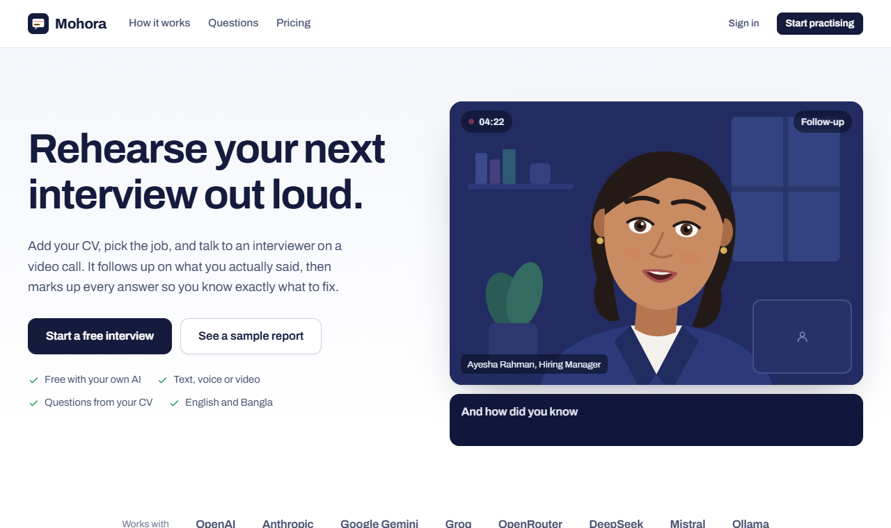
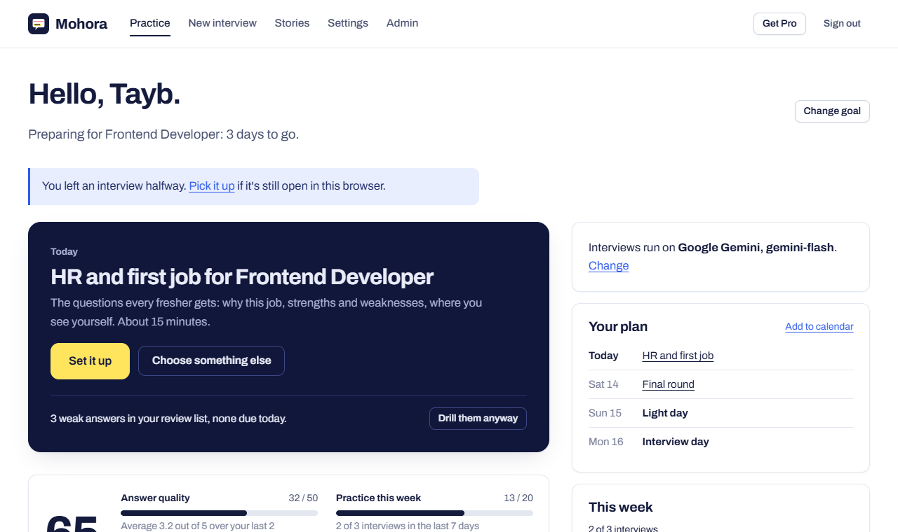
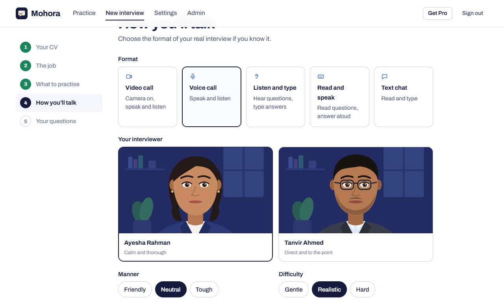

# Mohora

Practise job interviews out loud. Mohora reads your CV, suggests roles that fit, and runs a video, voice or text interview with an AI interviewer who follows up on what you actually said. Every answer comes back scored, marked up and rewritten in your own words.

It runs on the AI you already have: sign in with OpenRouter or Puter, paste a free Google Gemini or Groq key, use OpenAI, Anthropic, DeepSeek, Mistral and others, or run a model locally with Ollama. Keys and CVs never leave the browser, so practice costs the site almost nothing and can stay free.



Most practice tools stop at one mock interview and a score. Mohora is built around the interview date: a daily plan, a readiness score you can see into, and weak answers that keep coming back until they land.



## What it does

- **CV first.** Upload a PDF or Word CV. The AI pulls out your profile, suggests roles from internship to lead, and lists the topics an interviewer will ask about. You pick the topics.
- **Check the fit.** Paste a job post and get a screening score, missing keywords and concrete CV fixes.
- **Eleven interview types**, each with its own interviewer, questions and rubric. Seven for jobs: behavioral (STAR), role interview, HR and first job, job description match, online application questions, recruiter screen and final round. Four specialist ones in Pro, each with one free try: salary negotiation, US student visa (F-1), IELTS speaking and viva board.
- **A plan and a readiness score.** Set the interview date and get one short session per day, a light day before and a warm-up on the day. The score out of 100 is the sum of four visible parts, so it's clear what raises it.
- **Weak answers come back.** Any answer under 4 out of 5 joins a review list and returns in a five-minute drill after one, three and seven days. Three good answers in a row retire it.
- **Story bank.** Save an answer from a report as a STAR story, tidy it with AI, tag what it shows, and see which kinds of story are missing.
- **Specific feedback, not generic.** Behavioral answers show which STAR parts were there and which were missing, next to the marked-up transcript.
- **Share a result.** A public page with scores and summary only; the answers stay private. Invite a friend and both get a week of Pro.
- **Question library.** A public page of the questions by interview type, each one a click away from practising it.
- **The whole hiring process (Pro).** Practise the steps of a real application in order, from the written form to the final round, and skip the ones you don't need.
- **Five ways to talk:** video call with your camera, voice call, listen and type, read and speak, or text chat.
- **Two drawn interviewers** whose faces follow the conversation: they blink, look up while thinking, nod while you speak, raise their brows on a follow-up, and move their lips with the audio of their voice.
- **Natural voices.** Edge's neural voices, a neural voice that runs in the browser (Kokoro), or OpenAI's voice through your own key. It measures the device first and only uses the in-browser voice when it can keep up.
- **Feedback you can act on.** Your words come back highlighted (strong lines, weak lines, filler words), scored on five points, with a rewrite and a "fix this next". Redo any question.
- **Owner tools.** Admin panel with funnel and usage numbers, user management, interview types and prompts editable as JSON, payments review, site flags, a Telegram alert for every new sign-up and a daily digest at 9 pm.
- **Pro for 1 USDT.** TRC20 payments are verified on the TRON blockchain automatically; BEP20 payments go to the admin queue.



## How it works

```
Browser                                              Server (FastAPI, SQLite)
─────────────────────────────────────────────        ─────────────────────────────
CV text, API key, prompts ──► your AI provider        accounts (Google sign-in)
interview director (when to follow up, move on,       saved reports and scores
  give feedback, score)                                admin panel, payments
speech recognition, voices, avatar animation           Telegram alerts
```

The model only voices the interviewer. A small director in `static/room.js` owns the interview: it decides when to ask a follow-up, when to move on, when feedback appears and what the rubric is. The model gets one short instruction per turn and must answer in JSON. That is what keeps small free models on track and lets every interview type be plain data (`app/packs.json`), editable from the admin panel without a deploy.

## Decisions worth explaining

- **Bring your own AI.** Paying for every user's tokens would make a free tier impossible. With BYOK the hosting cost is a small server and the free tier is real.
- **Calls go from the browser to the provider.** The server never sees keys or CVs. A relay exists only for providers that block browser requests, and it forwards without storing or logging.
- **No build step.** Plain ES modules, one CSS file, server-rendered Jinja templates. Anyone can read the source the browser runs.
- **SQLite.** One file, WAL mode, backups with `python run.py backup`. Plenty for this kind of traffic, nothing to operate.
- **Drawn avatars instead of video avatars.** Photo-real talking heads need paid APIs. Animated SVG faces are free, instant and honest about being a practice partner.
- **Cross-origin isolation only in the room.** It lets the in-browser voice use every CPU core, but would break sign-in popups elsewhere.

## Run it

Python 3.12 or newer.

```bash
python run.py
```

The first run creates `.venv`, installs packages, asks a few questions to write `.env`, creates the database and opens the browser. Without Google credentials the sign-in page offers an email-only login for local testing.

| Command | What it does |
|---|---|
| `python run.py` | Development server with auto-reload |
| `python run.py check` | Lint, tests and a configuration check |
| `python run.py tg-test` | Send a Telegram test message and show chat ids |
| `python run.py admin you@example.com` | Make a user an admin |
| `python run.py backup` | Copy the database into `backups/` |
| `python run.py prod` | Production server |
| `python run.py deploy` | Print a systemd unit and Caddy config for your domain |

Settings live in `.env` (see `.env.example`): Google OAuth client, admin emails, Telegram bot token and chat id. Payment wallet addresses, the Pro price, prompts and feature flags are set in the admin panel.

## Project layout

```
run.py              one entry point for setup, dev, prod, checks, backups
app/main.py         pages, API, security headers
app/auth.py         Google sign-in, local sign-in, guards
app/billing.py      Pro passes, USDT payments, TRON verification
app/practice.py     practice hub: review schedule, readiness, plan, stories, sharing, question library
app/admin.py        admin panel
app/notify.py       Telegram alerts
app/db.py           models, migrations, settings
app/packs.json      interview types, hiring journey, prompts
static/room.js      interview room and director
static/setup.js     setup wizard
static/practice.js  drills, goal, story bank, share links
static/avatar.js    animated interviewers
static/voice.js     speech recognition, voices, answer metrics
static/app.js       AI connections and shared helpers
tests/test_app.py   tests
```

## Credits

Built with [FastAPI](https://fastapi.tiangolo.com), [kokoro-js](https://www.npmjs.com/package/kokoro-js), [pdf.js](https://mozilla.github.io/pdf.js/), [mammoth.js](https://github.com/mwilliamson/mammoth.js) and [segno](https://github.com/heuer/segno).

## License

MIT. See [LICENSE](LICENSE).
